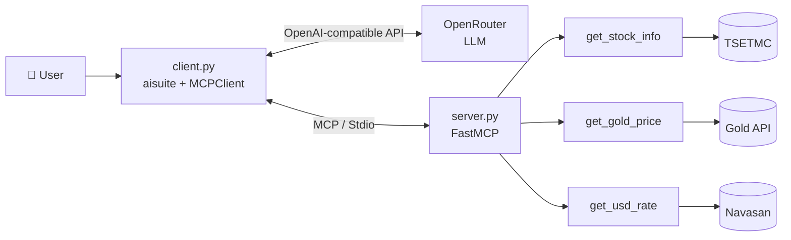

# 📈 Finance MCP: An AI Assistant for the Iranian Financial Market

A demo project that connects **Large Language Models (LLMs)** to **live Iranian market data** using the **Model Context Protocol (MCP)**.

The MCP server exposes three tools to the model: Tehran Stock Exchange symbol info, the global gold price, and the USD to Toman exchange rate. The interactive client lets the model decide which tools to call, with what arguments and in what order, and then compose a clear final answer in Persian.


---

## ✨ Features

- 🔌 **MCP server** built on `FastMCP`, communicating over Stdio
- 🛠️ **Three financial tools** whose Function Calling schemas are generated automatically from type hints and docstrings
- 🤖 **Interactive terminal client** built with `aisuite`, supporting any model available on **OpenRouter**
- 🔍 **Transparent tool activity**: every Tool Call (name and arguments) and Tool Result is printed
- 🥇 **Domestic 18k gold price calculation** that combines the global ounce price with the USD rate (multi-step tool use)
- 🧯 **Error handling**: tool failures are reported to the user, and the model will not compute a result from incomplete data

---

## 🧰 Tools

| Tool | Input | Data source | Output |
|---|---|---|---|
| `get_stock_info` | `symbol` (e.g. `فولاد`) | TSETMC via `pytse-client` | `symbol`, `name`, `last_price`, `price_change_percent`, `volume`, `market_cap`, `last_update` |
| `get_gold_price` | none | [Gold API](https://api.gold-api.com) | `symbol`, `price_usd_per_ounce`, `name` |
| `get_usd_rate` | none | [Navasan](https://navasan.tech) | `usd_sell_toman`, `last_update` |

> `market_cap` currently returns `None`, because `pytse-client` does not provide this field.

---

## 🏗️ Architecture



**How it works:**

1. The client launches `server.py` as a child process and fetches the list of available tools.
2. The user's question is sent to the model together with the tools and a system prompt.
3. The model calls the tools it needs (up to 5 rounds, `max_turns=5`).
4. Tool results are returned to the model, and the final answer is printed in Persian.

### 🥇 Gold price formula

The system prompt forces the model to follow these steps without skipping any:

```
24k gold per gram (Toman) = (ounce price ÷ 31.1) × USD rate
18k gold per gram         = 24k gold per gram × 0.75
```

If either tool fails or returns no data, the model skips the calculation and tells the user exactly which data was unavailable.

---

## 📁 Project Structure

```text
.
├── client.py            # Interactive client (aisuite + OpenRouter + MCPClient)
├── server.py            # MCP server and tool registration
├── requirements.txt     # Dependencies
├── .env                 # API keys (not committed to Git)
└── tools/
    ├── stock_info.py    # Stock symbol info
    ├── gold_price.py    # Global gold price
    └── usd_rate.py      # USD to Toman rate
```

---

## 🚀 Getting Started

### Prerequisites

- Python **3.10** or newer
- An API key from [OpenRouter](https://openrouter.ai)
- An API key from [Navasan](https://navasan.tech)

### Installation

```bash
# 1. Clone the repository
git clone https://github.com/akbarmohammadi70/iran-finance-mcp.git
cd iran-finance-mcp

# 2. Create and activate a virtual environment
python -m venv .venv
source .venv/bin/activate        # On Windows: .venv\Scripts\activate

# 3. Install dependencies
pip install -r requirements.txt
```

### Configuration

Create a `.env` file in the project root:

```env
OPENROUTER_API_KEY=your_openrouter_api_key
NAVASAN_API_KEY=your_navasan_api_key

# Optional. Default: openai/gpt-4o-mini
OPENROUTER_MODEL=openai/gpt-4o-mini
```

| Variable | Required | Description |
|---|:---:|---|
| `OPENROUTER_API_KEY` | ✅ | OpenRouter access key |
| `NAVASAN_API_KEY` | ✅ | Navasan API key (used by the USD rate tool) |
| `OPENROUTER_MODEL` | ❌ | Model name on OpenRouter; defaults to `openai/gpt-4o-mini` |

---

## ▶️ Usage

```bash
python client.py
```

You don't need to start `server.py` separately; the client launches it as a child process. Type `exit`, `quit` or `q` to leave (or press `Ctrl+C`).

### Example prompts

- `قیمت طلای ۱۸ عیار داخلی چنده؟` (What is the domestic 18k gold price?)
- `اطلاعات سهم فولاد رو بده` (Give me info on the Foolad stock)
- `نرخ دلار الان چقدره؟` (What is the current dollar rate?)

Before the final answer, you can see every Tool Call and Tool Result:

```text
============================================================
🔧 MCP TOOL ACTIVITY
============================================================

📤 TOOL CALL
   Tool      : get_gold_price
   Arguments : {}

📥 TOOL RESULT
   Tool      : get_gold_price
   Result:
      ...
```

---

## 🧪 Running the Server Standalone

To test the server without the client, using MCP Inspector (requires [Node.js](https://nodejs.org) so that `npx` is available):

```bash
mcp dev server.py
```

This step is optional; `python client.py` already starts the server for you.

---

## 🛠️ Tech Stack

- [MCP Python SDK](https://github.com/modelcontextprotocol/python-sdk) (`FastMCP`)
- [aisuite](https://github.com/andrewyng/aisuite) for LLM and MCP integration
- [OpenRouter](https://openrouter.ai) as the model gateway
- [pytse-client](https://github.com/Glyphack/pytse-client) for TSETMC data
- `requests` and `python-dotenv`

---

## ⚠️ Disclaimer

This project is for educational purposes only. Calculated prices are **approximations** and differ from actual domestic market prices (which include fees, taxes and market premiums). Nothing here is investment advice.

---

## 👤 Author

**<Akbar Mohammadi>** · Senior DevOps Engineer
[GitHub](https://github.com/akbarmohammadi70) · [LinkedIn](https://www.linkedin.com/in/akbar-mohammadi70)
